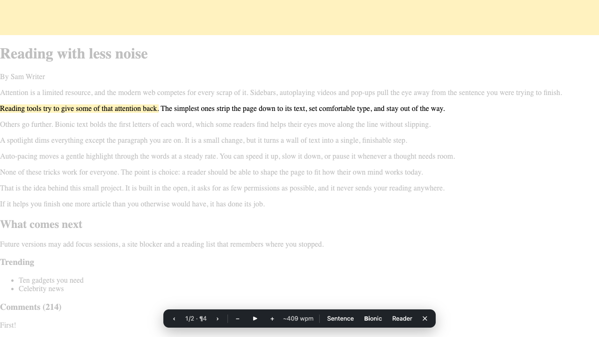
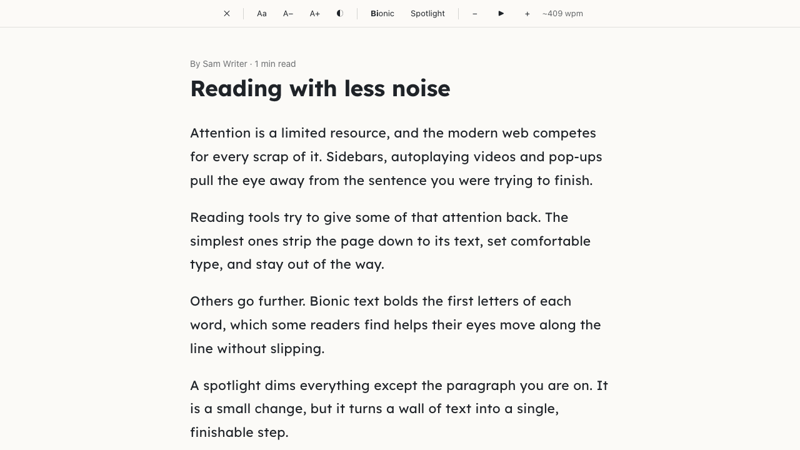
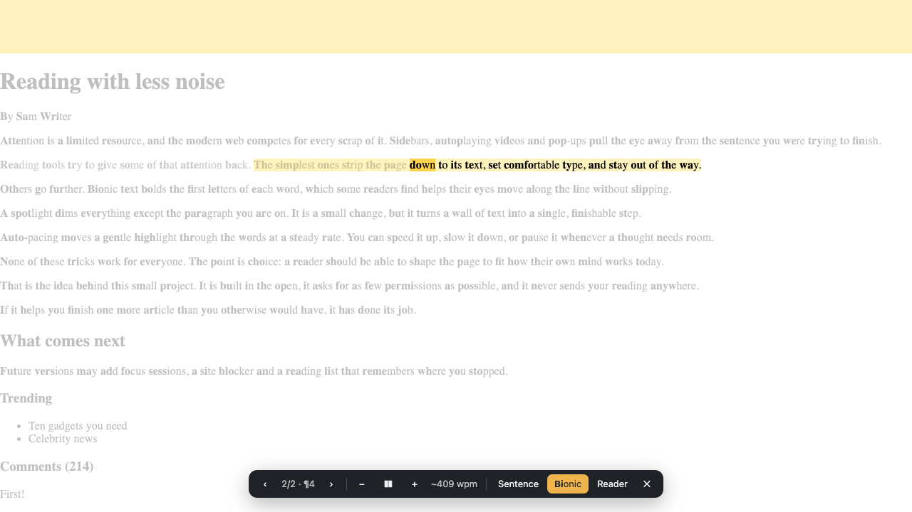
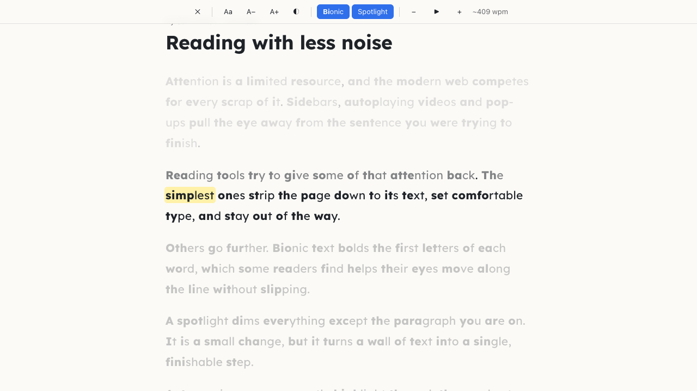

# Focus Reader

**A Chrome extension that helps you actually finish what you start reading.** Focus on the page you're already on,
one sentence at a time, or open a clean reader view. Bionic text and auto-pacing help keep your eyes moving.

[](https://github.com/mhndkhasawneh/focus-reader/actions/workflows/ci.yml)


[](LICENSE)

| In-page focus | Reader view |
|---|---|
|  |  |
|  |  |

## Why

Long articles compete with sidebars, ads and autoplay for your attention. Reading tools for ADHD and focus
usually solve this with an account, a subscription and permission to read every site you visit. Focus Reader
does the same job locally: **no account, no server, no tracking**, and by default it only touches a page when you ask it to.

## The story behind it

I built the first version in an afternoon while trying out
[REA (Reverse Engineer Anything)](https://github.com/morluto/rea), an open-source tool that lets AI agents
analyze shipped software. I'd been using two reading extensions, [Nook](https://chromewebstore.google.com/detail/nook-focused-reading/nodkllppdponplhiigciielhobpnfdfm)
and [Focus Ex](https://chromewebstore.google.com/detail/focus-ex/dlchhkpnfagokiecakphcgilhgdimkkg). I liked both,
but both switch to a subscription after the trial. So I used REA to study how their features behave, wrote that
behaviour down, and steered Claude Code through a fresh implementation, checking each step against tests.
More in [my LinkedIn post](https://www.linkedin.com/feed/update/urn:li:activity:7518777210338664448/).

> Focus Reader is an independent project. It is not affiliated with or endorsed by Nook or Focus Ex, and it
> contains no code, text, fonts or other assets from either. It's a new implementation of similar reading techniques.

## Features

### Two ways to read
- **In-page focus** (`Alt+Shift+F`). Select any text and a toolbar appears. Hit **Focus** and the page around the
  current paragraph dims while the current sentence is highlighted, so you stay in the original page with its
  images, links and layout. Step with `↓` / `↑`, or click anywhere in the text to jump there.
- **Reader view** (`Alt+Shift+R`). Opens a clean, distraction-free copy of the article with adjustable typography and themes.

### Focus aids (both modes)
- **Auto-pacing.** A highlight moves through the text at your chosen speed (about 100 to 1000 wpm) and fades
  what you've read. It continues into the next paragraph on its own.
- **Bionic text.** Bolds the start of every word (adjustable strength) to guide fixation.
- **Spotlight.** Dims everything except the paragraph you're reading.
- **Typography.** Lexend and Atkinson Hyperlegible fonts, five themes, and controls for size, line height,
  letter spacing and column width.
- Right-click a selection → **Focus from here**. Every setting syncs across your Chrome profile.

## Privacy by design

| Permission | Why |
|---|---|
| `activeTab` + `scripting` | Runs only in the tab where you click the icon, press a shortcut or use the context menu |
| `storage` | Saves your reading preferences (Chrome sync storage) |
| `contextMenus` | The "Focus from here" right-click item |
| *optional* `<all_urls>` | Requested **only** if you turn on "show the toolbar whenever I select text" in Options |

The extension makes no network requests.

## Install

```bash
git clone https://github.com/mhndkhasawneh/focus-reader.git
cd focus-reader
npm install
npm run build
```

1. Open `chrome://extensions` and turn on **Developer mode**.
2. Click **Load unpacked** and select `dist/chrome-mv3`.
3. Open an article and press `Alt+Shift+F`, or click the toolbar icon. Right-click the icon → **Options** for settings.

## Keyboard shortcuts

| Key | Action |
|---|---|
| `Alt+Shift+F` / `Alt+Shift+R` | Start in-page focus / open reader view |
| `↓` `↑` (or `j` `k`) | Next / previous sentence or paragraph |
| `Space` | Start / pause auto-pacing |
| `[` `]` | Slower / faster |
| `b` | Toggle bionic text |
| `s` | In-page: step by sentence or by paragraph |
| `f`, `-` `+` | Reader: spotlight, text size |
| `Esc` | Exit |

## How it works

- **No page edits for highlighting.** In-page focus paints sentences and words with the
  [CSS Custom Highlight API](https://developer.mozilla.org/docs/Web/API/CSS_Custom_Highlight_API). Dimming is a
  single fixed element whose giant `box-shadow` leaves a cut-out over the current paragraph. The page's DOM stays
  untouched, so its scripts, links and layout keep working. Bionic text is the one feature that has to wrap text
  nodes, and it is fully reverted on exit. The end-to-end test checks that the article's HTML is byte-identical afterwards.
- **Text model.** `lib/flow/model.ts` maps each readable block to plain text with node offsets, so any sentence
  or word becomes a DOM `Range` in O(log n).
- **Sentence segmentation.** `Intl.Segmenter`, plus an abbreviation merge ("Dr.", "e.g.", initials), because
  Chrome ships no sentence-break suppression data.
- **Reader view.** [Mozilla Readability](https://github.com/mozilla/readability) extracts the article, an
  allowlist sanitizer strips scripts, handlers and `javascript:` URLs, and the result renders in a shadow root.
- **Pacing engine.** `lib/pacer.ts` is a pure, frame-rate-independent step function (deltas capped at 50 ms) that
  is unit-tested without a DOM.

```
entrypoints/
  background.ts         icon, shortcuts, context menu, opt-in content-script registration
  flow.content.ts       in-page focus controller (selection toolbar + session)
  reader.content.ts     reader view toggle
  options/              settings page
lib/
  flow/                 segment.ts · model.ts · session.ts · toolbar.ts
  overlay.ts            reader view UI
  extract.ts            Readability + sanitizer
  pacer.ts · bionic.ts · settings.ts · fonts.ts
tests/                  unit tests (Vitest) and e2e/ (Playwright, real extension in Chromium)
```

Built with [WXT](https://wxt.dev) and TypeScript (strict).

## Development

```bash
npm run dev        # Chrome with live reload
npm run typecheck
npm test           # unit tests
npm run test:e2e   # builds a test variant and drives the real extension in Chromium
```

## Roadmap

- [ ] Natural pauses at punctuation while auto-pacing
- [ ] Skim mode: highlight key words
- [ ] Focus sessions (pomodoro) with a site blocker
- [ ] Reading list with saved position
- [ ] Read aloud with the browser's built-in voices

## License

[MIT](LICENSE) © Mohannad Khasawneh. Bundled fonts (Lexend, Atkinson Hyperlegible) are under the SIL Open Font
License; see `public/fonts/`.
