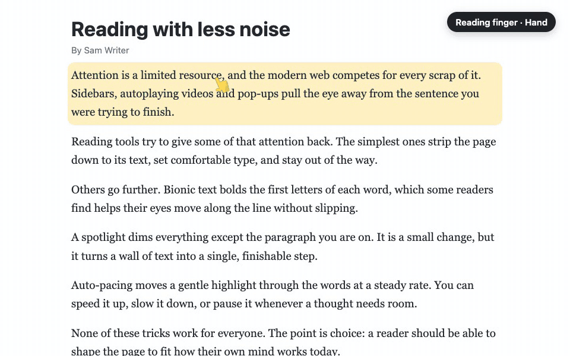
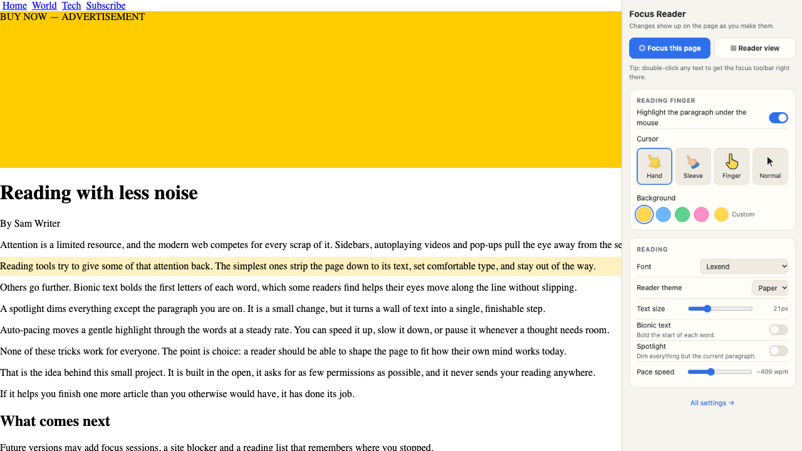

# Focus Reader

**A Chrome extension that helps you actually finish what you start reading.** Focus on the page you're already on,
one sentence at a time, or open a clean reader view. Bionic text and auto-pacing help keep your eyes moving, and a
"reading finger" highlights the paragraph under your mouse on any page, like following the line with your finger.

[](https://github.com/mhndkhasawneh/focus-reader/actions/workflows/ci.yml)


[](LICENSE)



| In-page focus | Reader view |
|---|---|
|  |  |
|  |  |

## Why

Long articles compete with sidebars, ads and autoplay for your attention. Reading tools for ADHD and focus
usually solve this with an account, a subscription and permission to read every site you visit. Focus Reader
does the same job locally: **no account, no server, no tracking**. On every page it runs only a small script for the
reading finger and the double-click toolbar; everything else loads when you ask for it, and nothing you read ever
leaves your browser.

## The story behind it

I built the first version in an afternoon while trying out
[REA (Reverse Engineer Anything)](https://github.com/morluto/rea), an open-source tool that lets AI agents
analyze shipped software. I'd been using two reading extensions, [Nook](https://chromewebstore.google.com/detail/nook-focused-reading/nodkllppdponplhiigciielhobpnfdfm)
and [Focus Ex](https://chromewebstore.google.com/detail/focus-ex/dlchhkpnfagokiecakphcgilhgdimkkg). I liked both,
but both switch to a subscription after the trial. So I used REA to study how their features behave, wrote that
behaviour down, and steered Claude Code through a fresh implementation, checking each step against tests.
More in [my LinkedIn post](https://www.linkedin.com/feed/update/urn:li:activity:7518777210338664448/).

> Focus Reader is an independent project. It is not affiliated with or endorsed by Nook or Focus Ex, and it
> contains no code, text, fonts or other assets from either. It's a new implementation of similar reading techniques.

## Features

### Two ways to read
- **In-page focus** (`Alt+Shift+F`, or click the toolbar icon). Or double-click any text on any page and a small
  toolbar appears above it with **Focus**, **Pace**, **Bionic** and **Reader**. Hit **Focus** and the page around the
  current paragraph dims while the current sentence is highlighted, so you stay in the original page with its
  images, links and layout. Step with `↓` / `↑`, or click anywhere in the text to jump there.
- **Reader view** (`Alt+Shift+R`). Opens a clean, distraction-free copy of the article with adjustable typography and themes.

### Settings sidebar
- Clicking the toolbar icon starts in-page focus (or reader view, if that's your default) and opens a sidebar
  docked next to the page. Every change shows on the page as you make it.
- **Focus this page** / **Reader view** buttons, the reading finger's cursor and colour, and the everyday reading
  settings: font, reader theme, text size, bionic text, spotlight and pace speed.
- **All settings** opens the full Options page. Both stay in sync.



### Reading finger (on by default, every page)
- Like following the line with your finger: a soft, rounded background sits behind the paragraph under your mouse
  and follows it from paragraph to paragraph.
- **Cursor:** over a highlighted paragraph the mouse becomes a pointing hand. Choose **Hand** (flat, two-tone, in
  your highlight colour), **Sleeve** (skin-tone hand with a blue cuff), **Finger** (outlined, in your highlight
  colour) or **Normal** (the page's own cursor).
- **Background:** yellow, blue, green, pink or any custom colour. It's drawn translucent so text stays readable on
  light and dark sites.
- It needs nothing from the page beyond the element under the pointer, so it also works as a fallback on pages
  where in-page focus can't find the article, including content inside embedded frames. It steps aside while
  in-page focus or reader view is open and comes back when you exit. Turn it off in the sidebar or Options.

### Focus aids (both modes)
- **Auto-pacing.** A highlight moves through the text at your chosen speed (about 100 to 1000 wpm) and fades
  what you've read. It continues into the next paragraph on its own.
- **Bionic text.** Bolds the start of every word (adjustable strength) to guide fixation.
- **Spotlight.** Dims everything except the paragraph you're reading.
- **Typography.** Lexend and Atkinson Hyperlegible fonts, five themes, and controls for size, line height,
  letter spacing and column width.
- Right-click a selection → **Focus from here**. Every setting syncs across your Chrome profile.
- Want the toolbar on every selection, not only on double-click? Turn on "Show the focus toolbar on every text
  selection" in Options.

## Privacy by design

| Permission | Why |
|---|---|
| Site access on `http(s)://*/*` | Chrome shows this as "read and change your data on all websites". A small script on every page runs the reading finger (it only tracks which paragraph the mouse is over and marks it with one attribute) and listens for double-clicks. In-page focus and reader view are injected only when you double-click, click the icon, press a shortcut or use the sidebar |
| `activeTab` + `scripting` | Injecting in-page focus and reader view into the tab you're using |
| `sidePanel` | The settings sidebar |
| `storage` | Saves your reading preferences (Chrome sync storage) |
| `contextMenus` | The "Focus from here" right-click item |

The extension makes no network requests.

## Install

```bash
git clone https://github.com/mhndkhasawneh/focus-reader.git
cd focus-reader
npm install
npm run build
```

1. Open `chrome://extensions` and turn on **Developer mode**.
2. Click **Load unpacked** and select `dist/chrome-mv3`.
3. Open an article and click the toolbar icon (starts focus and opens the sidebar), double-click any text, or press
   `Alt+Shift+F`. Right-click the icon → **Options** for every setting.

After pulling changes, run `npm run build` again, press the reload button (↻) on Focus Reader's card in
`chrome://extensions`, and refresh any open tabs. Switching the extension off and on is not enough when the
manifest changes, and tabs opened before the reload don't get the new page script. If the reading finger doesn't
appear, check **Details → Site access** is set to "On all sites".

## Keyboard shortcuts

| Key | Action |
|---|---|
| Double-click text | Show the focus toolbar (Focus, Pace, Bionic, Reader) |
| `Alt+Shift+F` / `Alt+Shift+R` | Start in-page focus / open reader view |
| `↓` `↑` (or `j` `k`) | Next / previous sentence or paragraph |
| `Space` | Start / pause auto-pacing |
| `[` `]` | Slower / faster |
| `b` | Toggle bionic text |
| `s` | In-page: step by sentence or by paragraph |
| `f`, `-` `+` | Reader: spotlight, text size |
| `Esc` | Exit |

## How it works

- **Reading finger.** `lib/hover.ts` walks up from the element under the mouse past inline elements to the first
  block that holds text itself, skipping containers and anything taller than the viewport. It marks that block with
  a `data-focus-reader-hover` attribute styled from one `<style>` element, so text and layout never change. The
  cursors are small inline SVGs turned into `data:` URLs, with the hotspot on the fingertip. It notices in-page focus
  or reader view by watching for their elements on `<html>`, so the modes don't need to know about it.
- **Double-click toolbar.** The always-on script stays tiny. On a double-click it messages the background, which
  injects the in-page focus code into that tab and frame and shows the toolbar for the selection.
- **Sidebar and Options.** Both pages use `lib/settings-form.ts`, which binds form controls to settings by `name` and
  listens for changes, so the sidebar, the Options page and every open tab stay in sync.
- **No page edits for highlighting.** In-page focus paints sentences and words with the
  [CSS Custom Highlight API](https://developer.mozilla.org/docs/Web/API/CSS_Custom_Highlight_API). Dimming is a
  single fixed element whose giant `box-shadow` leaves a cut-out over the current paragraph. The page's DOM stays
  untouched, so its scripts, links and layout keep working. Bionic text is the one feature that has to wrap text
  nodes, and it is fully reverted on exit. The end-to-end test checks that the article's HTML is byte-identical afterwards.
- **Text model.** `lib/flow/model.ts` maps each readable block to plain text with node offsets, so any sentence
  or word becomes a DOM `Range` in O(log n).
- **Sentence segmentation.** `Intl.Segmenter`, plus an abbreviation merge ("Dr.", "e.g.", initials), because
  Chrome ships no sentence-break suppression data.
- **Reader view.** [Mozilla Readability](https://github.com/mozilla/readability) extracts the article, an
  allowlist sanitizer strips scripts, handlers and `javascript:` URLs, and the result renders in a shadow root.
- **Pacing engine.** `lib/pacer.ts` is a pure, frame-rate-independent step function (deltas capped at 50 ms) that
  is unit-tested without a DOM.

```
entrypoints/
  background.ts         icon, sidebar, shortcuts, context menu, double-click and opt-in toolbar
  flow.content.ts       in-page focus controller (selection toolbar + session)
  reader.content.ts     reader view toggle
  hover.content.ts      reading finger + double-click toolbar (the only always-on script)
  sidepanel/            settings sidebar
  options/              settings page
lib/
  flow/                 segment.ts · model.ts · session.ts · toolbar.ts
  overlay.ts            reader view UI
  extract.ts            Readability + sanitizer
  hover.ts              reading finger: paragraph finder, highlight, cursors
  settings-form.ts      form <-> settings binding shared by the sidebar and Options
  messages.ts           messages between pages, the sidebar and the background
  pacer.ts · bionic.ts · settings.ts · fonts.ts
tests/                  unit tests (Vitest) and e2e/ (Playwright, real extension in Chromium)
scripts/record-demo.mjs records docs/demo.gif with the real extension
```

Built with [WXT](https://wxt.dev) and TypeScript (strict).

## Development

```bash
npm run dev        # Chrome with live reload
npm run typecheck
npm test           # unit tests
npm run test:e2e   # builds a test variant and drives the real extension in Chromium
npm run demo       # re-records docs/demo.gif (needs ffmpeg)
```

Headless Chromium doesn't paint the mouse pointer into recordings, so the demo script draws it: it reads the cursor the
extension set on the element under the mouse and shows that image at the pointer. Everything else in the GIF is the
extension running as shipped.

## Changelog

**2026-11-09**
- Reading finger: highlights the paragraph under the mouse on every page, on by default, with Hand, Sleeve,
  Finger and Normal cursors and a choice of colour.
- Settings sidebar: opens with the toolbar icon, with live controls for the reading finger and everyday reading settings.
- Double-click any text to bring up the focus toolbar, with no icon click first.
- Demo GIF at the top of this README, recorded by `npm run demo`.
- Permissions: site access on all http(s) pages, in place of the optional permission that the "toolbar on every
  selection" option used to ask for.

## Roadmap

- [ ] Natural pauses at punctuation while auto-pacing
- [ ] Skim mode: highlight key words
- [ ] Focus sessions (pomodoro) with a site blocker
- [ ] Reading list with saved position
- [ ] Read aloud with the browser's built-in voices

## License

[MIT](LICENSE) © Mohannad Khasawneh. Bundled fonts (Lexend, Atkinson Hyperlegible) are under the SIL Open Font
License; see `public/fonts/`.
